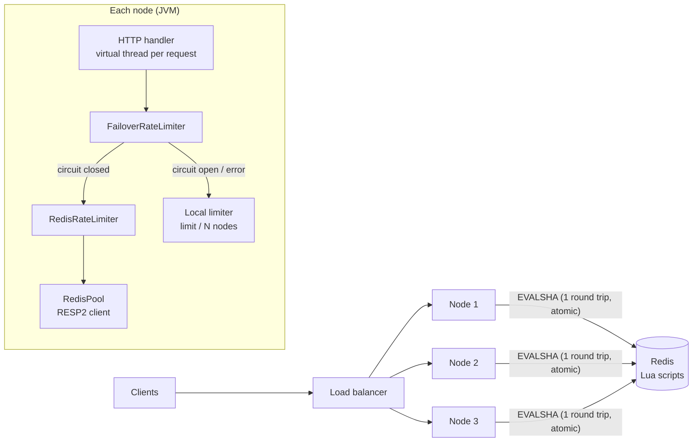

# distributed-rate-limiter

Rate limiting as a library and as a service. It offers three algorithms (token bucket, sliding window log, sliding window counter) and two backends: **in-process** (lock-free) and **distributed** (Redis + atomic Lua scripts), with a circuit breaker and a configurable failure mode for when Redis is down.

Java 21, **zero runtime dependencies**: the Redis client (RESP2) and the HTTP server (JDK `HttpServer` on virtual threads) are built on the JDK.

```
4 nodes x 16 threads hammering one key for 10 s, limit = burst 100 + 200 req/s

| strategy | attempts    | admitted | max allowed | over-admission |
|----------|-------------|----------|-------------|----------------|
| local    |  98,948,120 |    8,338 |       2,102 |         +297%  |   <- each node limits alone
| redis    |     542,353 |    2,089 |       2,100 |          none  |   <- shared state, atomic Lua
```

---

## Contents

- [Quick start](#quick-start)
- [HTTP API](#http-api)
- [Using it as a library](#using-it-as-a-library)
- [Architecture](#architecture)
- [Algorithms and trade-offs](#algorithms-and-trade-offs)
- [Distributed design decisions](#distributed-design-decisions)
- [Failure handling](#failure-handling)
- [Concurrency in local mode](#concurrency-in-local-mode)
- [Results](#results)
- [Testing](#testing)
- [Configuration](#configuration)
- [Limitations and next steps](#limitations-and-next-steps)

---

## Quick start

Requirements: JDK 21+, Maven 3.9+, and Redis 6.2+ for distributed mode.

```bash
mvn -q package                       # builds and runs all tests (Redis tests skip if no Redis)
java -jar target/distributed-rate-limiter.jar          # LOCAL mode on :8080

redis-server &                                         # distributed mode
RL_MODE=REDIS java -jar target/distributed-rate-limiter.jar
```

Try it:

```bash
for i in $(seq 1 7); do
  curl -s -o /dev/null -w "%{http_code} " -H "X-Client-Id: alice" localhost:8080/demo/hello
done
# 200 200 200 200 200 429 429      (rule "demo": burst 5, refill 1/s)
```

**Three nodes, one limit.** Either with Docker:

```bash
docker compose up --build            # redis + 3 nodes + nginx round-robin on :8080
```

or without Docker:

```bash
./scripts/local-cluster-demo.sh
#   request 1 -> node :8081 -> HTTP 200
#   ...
#   request 5 -> node :8082 -> HTTP 200
#   request 6 -> node :8083 -> HTTP 429      <- 5 in total across all nodes
```

**Benchmarks and the correctness check:**

```bash
java -cp target/classes dev.ratelimiter.bench.DistributedCorrectnessCheck --nodes 4 --threads 16 --seconds 10
java -cp target/classes dev.ratelimiter.bench.Benchmark --mode local,redis --threads 1,8 --keys 1,10000
```

---

## HTTP API

| Method | Path | Purpose |
|---|---|---|
| `POST` | `/v1/ratelimit/{rule}?key=K&permits=N` | Take N permits (default 1) for key K. `200` if allowed, `429` if not |
| `GET` | `/v1/rules` | Configured rules |
| `GET` | `/demo/hello` | Sample endpoint protected by rule `demo`, keyed by `X-Client-Id` (or client IP) |
| `GET` | `/healthz` | Liveness and Redis status (stays `200` when Redis is down; the failure mode keeps serving) |
| `GET` | `/metrics` | Prometheus metrics |

```http
POST /v1/ratelimit/login?key=bob

HTTP/1.1 429
RateLimit-Limit: 5
RateLimit-Remaining: 0
RateLimit-Reset: 60
RateLimit-Policy: 5;w=60
Retry-After: 60

{"allowed":false,"rule":"login","key":"bob","limit":5,"remaining":0,
 "retryAfterMs":59919,"resetAfterMs":59976,"degraded":false}
```

Headers follow the IETF *RateLimit header fields for HTTP* draft, plus the standard `Retry-After`. `retryAfterMs` is exact, never early: retrying after it succeeds unless other clients take the permits first. Tests assert this for every algorithm. Decisions made without Redis carry `X-RateLimit-Degraded: true`.

**Metrics:** `ratelimiter_decisions_total{rule,outcome}`, `ratelimiter_degraded_decisions_total{rule}`, `ratelimiter_decision_latency_seconds` (histogram), `ratelimiter_circuit_open{rule}`, `ratelimiter_redis_open_connections`, `ratelimiter_local_tracked_keys`.

---

## Using it as a library

```java
// In-process
RateLimiter api = new LocalTokenBucketLimiter(RateLimitRule.tokenBucket("api", 100, 50));

// Distributed, with failover
RedisPool pool = new RedisPool(RedisConfig.defaults("redis.internal", 6379));
RateLimitRule rule = RateLimitRule.slidingWindowLog("login", 5, 60_000);
RateLimiter login = new FailoverRateLimiter(
        new RedisRateLimiter(rule, pool),
        new LocalSlidingWindowLogLimiter(rule.dividedBy(3)),   // per-node share while Redis is down
        FailureMode.LOCAL_FALLBACK,
        new CircuitBreaker(5, 2_000, Clock.monotonic()));

Decision d = login.tryAcquire("user:42");
if (!d.allowed()) {
    response.setStatus(429);
    response.setHeader("Retry-After", String.valueOf((d.retryAfterMillis() + 999) / 1000));
}
```

---

## Architecture



```
src/main/java/dev/ratelimiter/
├── api/          RateLimiter, RateLimitRule, Decision, Clock
├── algorithm/    TokenBucket, SlidingWindowCounter: pure (state, now) -> (state', decision)
├── local/        lock-free in-process limiters + idle-key eviction
├── redis/        RespConnection (RESP2), RedisPool, LuaScript (EVALSHA/NOSCRIPT), RedisRateLimiter
├── resilience/   CircuitBreaker, FailureMode, FailoverRateLimiter
├── config/       properties + env overrides, RateLimiterRegistry
├── metrics/      LongAdder counters + histogram -> Prometheus text
├── server/       RateLimiterServer (JDK HttpServer, virtual threads)
└── bench/        Benchmark, DistributedCorrectnessCheck
src/main/resources/lua/   token_bucket.lua, sliding_window_log.lua, sliding_window_counter.lua
```

The algorithms are written once as **pure state transitions** (`algorithm/`). Local limiters wrap them in CAS loops; the Lua scripts mirror the same arithmetic line for line. That keeps the two backends behaviourally identical and makes the math unit-testable with a fake clock.

---

## Algorithms and trade-offs

| | Token bucket | Sliding window log | Sliding window counter |
|---|---|---|---|
| Semantics | burst up to `capacity`, then `rate`/s | exactly ≤ `limit` in any `window` | ≈ `limit` per window, weighted estimate |
| Memory per key | O(1): tokens + timestamp | **O(limit)**: one timestamp per request | O(1): two counters + window index |
| Accuracy | exact | exact | approximate (assumes even spread in the previous window) |
| Boundary burst | n/a | none | none (fixed windows allow 2× at the boundary; this does not) |
| Redis structure | hash `{tokens, ts}` | sorted set (score = time) | hash `{w, c, p}` |
| Good for | general API traffic, bursty clients | login / OTP / payments: low volume, must be exact | high-volume quotas (search, tenant QPS) |

Details that matter:

- **Refill on read.** No timers. Tokens are computed from elapsed time when a key is touched, so idle keys cost nothing.
- **Denied requests consume nothing.** A rejected 5-permit request leaves the bucket untouched for smaller ones.
- **Clock going backwards never mints tokens** or resets a window early (tested).
- **Precision.** Lua's default number-to-string conversion keeps 14 significant digits, but a microsecond epoch timestamp has 16. The scripts format explicitly (`%.0f` / `%.17g`) before storing; otherwise timestamps silently lose their last two digits.
- **Exact `retryAfter`.** For the log: the `(count + permits - limit)`-th oldest entry must expire. For the counter: solve `prev·(1 − f) + cur + permits ≤ limit` for `f`, rolling into the next window if needed.

---

## Distributed design decisions

**1. One atomic Lua script per decision.** The read-modify-write (read state, refill, compare, write) runs inside Redis, where scripts execute atomically. That gives one network round trip, no race between nodes, and no `WATCH`/`MULTI` optimistic retry loop that collapses under contention on hot keys. The multi-node test (4 nodes × 8 threads, 6,400 attempts on one key) admits **exactly** the limit.

**2. Redis server time, not caller time.** Scripts call `redis.call('TIME')`. App servers with skewed clocks still share one timeline; a node whose clock runs 2 s fast can't refill buckets early. (On Redis < 7 the scripts enable `redis.replicate_commands()` so a non-deterministic `TIME` can precede writes.)

**3. One key per decision, keyed `rl:<rule>:<key>`.** Every script touches exactly one key, so it works on Redis Cluster unchanged and keys spread across shards. A hash tag like `{rule}` would pin a whole rule to one shard: a self-inflicted hot spot.

**4. TTL on every key.** Token bucket: time to refill completely (after that, a missing key equals a full bucket). Log: the window. Counter: two windows. Redis reclaims idle state automatically; high-cardinality keys (IPs) don't leak memory.

**5. EVALSHA with NOSCRIPT fallback.** The SHA-1 is computed client-side; normal calls send 40 bytes instead of the script. After a restart, failover or `SCRIPT FLUSH`, the first call gets `NOSCRIPT`, falls back to `EVAL` (which re-caches), and carries on. Tested.

**6. Unique sorted-set members.** Two requests in the same microsecond must not collapse into one ZSET entry, so members are `nodeId-sequence:i`.

**7. Fail-fast timeouts.** Connect 200 ms, read 100 ms, pool borrow 50 ms. A rate limiter is on every request's hot path; a slow answer is worse than applying the failure mode.

---

## Failure handling

```
 CLOSED --(5 consecutive errors)--> OPEN --(2 s cooldown)--> HALF_OPEN --(probe ok)--> CLOSED
                                     ^                           |
                                     +-------(probe fails)-------+
```

While the breaker is open, requests skip Redis entirely, so a dead Redis costs no added latency instead of a timeout per request. Then the configured **failure mode** applies:

| Mode | Behaviour | Use for |
|---|---|---|
| `FAIL_OPEN` | allow everything | product APIs where availability beats strictness |
| `FAIL_CLOSED` | deny everything (`Retry-After: 1`) | login, OTP, payment abuse protection |
| `LOCAL_FALLBACK` (default) | in-process limiter at `limit / expectedNodes` | keeps limiting approximately: neither a free-for-all nor an outage |

Verified live: with Redis killed mid-run, responses carry `X-RateLimit-Degraded: true`, the per-node share is enforced, `/healthz` reports `redis: DOWN` and stays 200, and after Redis restarts the next probe closes the circuit.

---

## Concurrency in local mode

- **Token bucket and counter are lock-free.** Each key holds an `AtomicReference` to an *immutable* state record. A request computes the next state and publishes it with one `compareAndSet`, retrying if it lost the race. No thread ever blocks another. `LocalConcurrencyTest` races 16 threads × 5,000 attempts on one key with time frozen and asserts exactly `limit` succeed (no lost updates).
- **Log uses a per-key `ReentrantLock`** because its state is a mutable ring buffer of primitive `long`s (no boxing, grows up to `limit`). It uses `ReentrantLock` rather than `synchronized` so Java 21 virtual threads aren't pinned to carrier threads.
- **Idle-key eviction** runs every 30 s and removes only state that already equals "no state" (full bucket, empty window). The race with a concurrent request is benign, and the reason is documented in `LocalLimiterSupport`.
- **Monotonic clock** (`System.nanoTime`) locally, so NTP adjustments can't affect limits.

---

## Results

Measured on a 2-vCPU cloud VM, Redis on the same host. Full table and analysis in [docs/BENCHMARKS.md](docs/BENCHMARKS.md).

| mode | algorithm | threads | keys | ops/sec | p50 | p99 |
|---|---|---|---|---|---|---|
| local | token bucket | 8 | 10,000 | ~14.0 M | 0.1 µs | 0.5 µs |
| local | token bucket | 8 | 1 (hot) | ~4.2 M | 0.3 µs | 7.3 µs |
| local | sliding window counter | 8 | 10,000 | ~13.3 M | 0.1 µs | 0.5 µs |
| local | sliding window log | 8 | 10,000 | ~5.3 M | 0.4 µs | 1.0 µs |
| redis | token bucket | 8 | 10,000 | ~51 k | 149 µs | 323 µs |
| redis | sliding window log | 8 | 10,000 | ~41 k | 181 µs | 470 µs |
| redis | sliding window counter | 8 | 10,000 | ~46 k | 161 µs | 426 µs |

Takeaways: local decisions cost about 100 ns. Hot-key CAS contention costs 3× throughput. Redis mode is bound by round trips, not Lua, so the algorithm barely matters there and batching or local pre-checks are the next lever.

---

## Testing

```bash
mvn test                                   # 47 tests; *IT tests need Redis (skip otherwise)
REDIS_HOST=... REDIS_PORT=... mvn test     # point at another Redis
```

| Suite | What it proves |
|---|---|
| `TokenBucketTest`, `SlidingWindowCounterTest`, `LocalSlidingWindowLogLimiterTest` | algorithm math with a manual clock: bursts, refill, exact `retryAfter`, boundary burst, clock skew, eviction |
| `LocalConcurrencyTest` | 16 threads on one key admit exactly `limit` (no lost CAS updates, no missing locks) |
| `RedisRateLimiterIT` | Lua scripts on real Redis: semantics, TTLs, NOSCRIPT recovery, **4 nodes × 8 threads hold the global limit exactly** |
| `RespConnectionIT` | RESP2 decoding (all reply types, UTF-8), error replies, fail-fast on unreachable Redis |
| `FailoverRateLimiterTest` | all failure modes, breaker opens / short-circuits / half-open probe / re-opens |
| `RateLimiterServerIT` | HTTP end to end: 200→429, headers, validation, per-client demo, metrics |
| `LimiterConfigTest` | properties parsing, env overrides, validation |

CI (GitHub Actions) runs the full suite against a Redis service container, then the correctness check and a short benchmark.

---

## Configuration

`src/main/resources/ratelimiter.properties` (or a file passed in `RL_CONFIG`). Any key can be overridden with `RL_<KEY_UPPERCASED_WITH_UNDERSCORES>`; rule names should therefore be lower-case without underscores.

```properties
mode=REDIS                       # LOCAL | REDIS
failure.mode=LOCAL_FALLBACK      # FAIL_OPEN | FAIL_CLOSED | LOCAL_FALLBACK
failure.expected.nodes=3
breaker.failure.threshold=5
breaker.open.ms=2000

rule.api.algorithm=TOKEN_BUCKET
rule.api.limit=100               # capacity (burst)
rule.api.refill.per.second=50

rule.login.algorithm=SLIDING_WINDOW_LOG
rule.login.limit=5
rule.login.window.ms=60000
```

```bash
RL_MODE=REDIS REDIS_HOST=redis RL_RULE_API_LIMIT=500 java -jar target/distributed-rate-limiter.jar
```

---

## Limitations and next steps

- **Redis replication is asynchronous.** On failover, the newest writes can be lost, so a few clients may get extra requests for one window. That's acceptable for rate limiting (unlike a ledger), and it's why this doesn't use Redlock-style consensus.
- **One round trip per decision.** Next levers: (a) *token leasing*, where each node takes tokens from Redis in batches of N and spends them locally, trading strictness for N× fewer calls; (b) a local pre-check that rejects keys known to be exhausted until their `retryAfter`; (c) pipelining.
- **Hot keys** (one tenant at huge QPS) concentrate on one shard. Mitigations: key splitting (`key#0..k`, each with `limit/k`), or leasing as above.
- **Multi-region:** per-region limits with async reconciliation, or a global limit split by regional traffic share.
- **Dynamic rules:** rules load at startup today; a config watcher or admin endpoint would allow hot reloads.
- **Microbenchmarks** use a built-in harness to stay dependency-free; JMH would be the next step for publication-grade numbers.

## License

MIT
